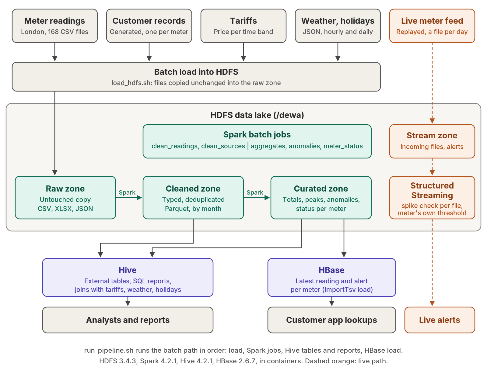
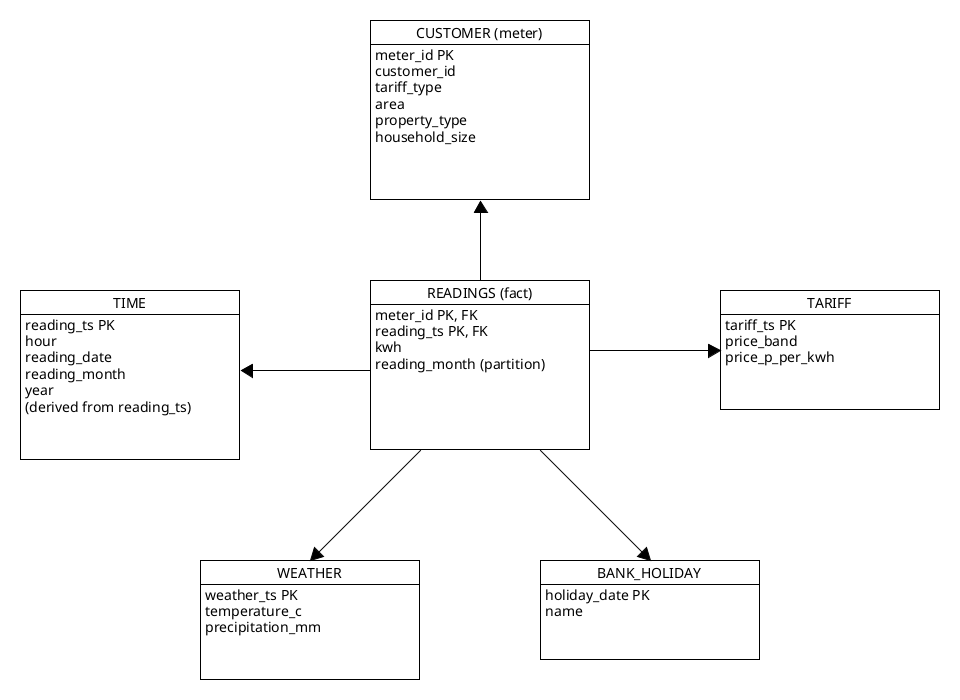

# Architecture

The full write-up (DEWA research, sizing, tool choice) is the architecture section of the report. This folder holds
the diagrams it uses.

## Data lake (`architecture.png`, source `architecture.svg`)

- **Batch path:** source files are copied unchanged into the raw zone (`data/load_hdfs.sh`). Spark cleans them into
  the cleaned zone (Parquet, by month), then builds the curated zone: hourly and daily totals with peaks, anomalies,
  and the latest status of each meter.
- **Serving:** Hive reads the cleaned and curated zones through external tables and joins the extra sources
  (tariffs, weather, bank holidays, customers) for reports. HBase holds the latest reading and alert per meter for
  lookups by meter ID, bulk loaded with `ImportTsv`.
- **Live path (dashed):** new readings land in the stream zone, and Spark Structured Streaming checks each file
  against every meter's own spike threshold within seconds (`spark/stream_alerts.py`).
- `run_pipeline.sh` runs the batch path in order.

To edit, change `architecture.svg` and export it again as a 1600 px wide PNG.

## Star schema (`star_schema.png`, UMLet source `star_schema.uxf`)

Logical schema of the readings data, drawn in UMLet as in Lab 5. `READINGS` is the fact table (one row per meter per
half hour, measure `kwh`). Its dimensions and how each one joins:

| Dimension | Hive table | Joins the fact on |
|---|---|---|
| CUSTOMER | `dewa.customers` | `meter_id` |
| TIME | none, derived from `reading_ts` | `reading_ts` (hour, date, month, year) |
| TARIFF | `dewa.tariffs` | `reading_ts = tariff_ts` (time-of-use meters only) |
| WEATHER | `dewa.weather` | the hour of `reading_ts = weather_ts` |
| BANK_HOLIDAY | `dewa.bank_holidays` | the date of `reading_ts = holiday_date` |

`hourly_usage` and `daily_usage` are the same fact at a coarser grain, and `anomalies` is an event fact that shares
the CUSTOMER and TIME dimensions. To edit, open `star_schema.uxf` in UMLet 14.2 and export it with File > Export as.
